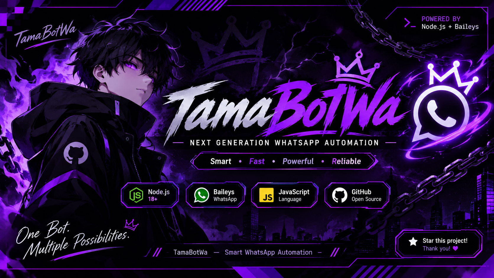

<div align="center">
  
</div>
<div align="center">

# ⚡ TamaBotWa

### `NEXT GENERATION WHATSAPP AUTOMATION`

**Smart • Fast • Powerful • Reliable**

[](https://nodejs.org/)
[](https://github.com/WhiskeySockets/Baileys)
[](https://developer.mozilla.org/en-US/docs/Web/JavaScript)
[](LICENSE)

*An advanced WhatsApp assistant built with Node.js and Baileys.*

[ FEATURES ](#-fitur-unggulan) • [ INSTALLATION ](#-installation) • [ CONFIGURATION ](#-configuration) • [ DEVELOPER ](#-developer)

</div>

---

## 🌌 ABOUT PROJECT

**TamaBotWa** adalah WhatsApp Assistant berbasis Node.js yang dirancang untuk menghadirkan pengalaman otomatisasi WhatsApp yang praktis, cepat, dan fleksibel.

Dibangun menggunakan library Baileys dengan sistem multi-file, pengelolaan plugin, serta konfigurasi yang mudah disesuaikan.

> 🚀 One bot. Multiple possibilities. Unlimited creativity.

---

## ✨ FITUR UNGGULAN

| Feature | Description |
|:---|:---|
| ⚡ Super Fast | Respons cepat dan ringan |
| 🧩 Plugin System | Sistem plugin modular |
| 🔐 Multi-File | Struktur kode lebih terorganisir |
| 🔄 Auto Reconnect | Mendukung koneksi ulang otomatis |
| 🔑 Pairing Code | Login menggunakan pairing code |
| 🗄️ Database | Penyimpanan data menggunakan database |
| ⚙️ Easy Configuration | Pengaturan melalui `config.js` |
| 📱 WhatsApp Integration | Terintegrasi dengan WhatsApp melalui Baileys |

---

## 🛠️ TECHNOLOGY STACK

<div align="center">


</div>

- **Runtime:** Node.js
- **Language:** JavaScript
- **WhatsApp Library:** Baileys
- **Storage:** Database
- **Project Structure:** Multi-file Architecture

---

## 📂 PROJECT STRUCTURE

```text
TamaBotWa/
│
├── 📁 database/
│   └── Database files
│
├── 📁 lib/
│   └── Core libraries
│
├── 📁 media/
│   └── Images and media
│
├── 📁 plugins/
│   └── Bot commands
│
├── 📄 config.js
├── 📄 handler.js
├── 📄 index.js
├── 📄 package.json
├── 📄 package-lock.json
│
└── 📄 README.md
```

---

## 🚀 INSTALLATION

### 1. Clone Repository

```bash
git clone https://github.com/tamayana/TamaBotWa.git
```

### 2. Enter Project Directory

```bash
cd TamaBotWa
```

### 3. Install Dependencies

```bash
npm install
```

### 4. Configuration

Buka file:

```text
config.js
```

Sesuaikan konfigurasi bot sesuai kebutuhan.

### 5. Start Bot

```bash
node index.js
```

Ikuti instruksi login yang tersedia pada terminal.

---

## ⚙️ CONFIGURATION

Semua pengaturan utama dapat disesuaikan melalui:

```text
config.js
```

Kamu dapat mengatur konfigurasi sesuai struktur dan fitur yang tersedia di dalam project.

---

## 🔒 SECURITY NOTICE

- Jangan membagikan session WhatsApp kepada orang lain.
- Jangan mengunggah kredensial atau informasi pribadi ke repository publik.
- Gunakan bot secara bertanggung jawab.
- Hormati privasi pengguna WhatsApp.

---

## 💜 DEVELOPER

<div align="center">

### TAMA DEVELOPER

**Created with passion & creativity.**

[](https://github.com/tamayana)

**TamaBotWa — Smart WhatsApp Automation.**

</div>

---

<div align="center">

### ⭐ LIKE THIS PROJECT?

If you find this project useful, consider giving it a star!

**THANK YOU FOR VISITING TAMA BOT WA**

<sub>© Rahmad Pratama — All Rights Reserved.</sub>

</div>
